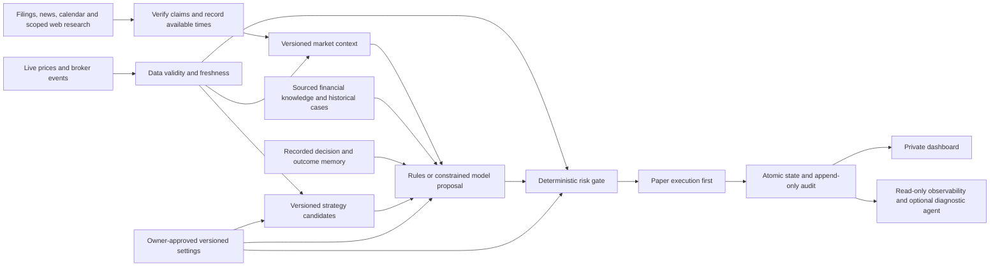

# Engineering Statement of Direction

- **Date:** 13 October 2026
- **Version:** 0.3; continuous intelligence, temporal validity and independent trading paths specified
- **Decision owner:** The personal account owner
- **Status:** Proposed engineering direction; owner resumed local paper implementation on 13 October 2026 after documentation review. Deployment, spending, broker connections and real trading remain later decisions.
- **Stage:** Research and partial prototype; trading edge and operating reliability are unvalidated.
- **Review trigger:** Resume instruction received; review the prototype defects now and resolve the live risk mandate before any later live stage.
- **Lifecycle context:** [Retained agreements and tool/access map](LIFECYCLE-AGREEMENTS.md)
- **Market research design:** [Intelligence sources and decision workflow](MARKET-INTELLIGENCE.md)

## Decision in focus

Build toward a private AI financial trading expert with the breadth, judgment and discipline expected of a seasoned practitioner with 20+ years across market cycles. Its purpose is to research opportunities, choose and manage trades coherently, and seek profitable use of the owner's capital. The experience reference defines the intended capability; it is not a claim that a model has lived trading experience or a verified track record.

The engineering direction must support expertise through sourced domain knowledge, relevant historical cases, current market/portfolio context, explicit decision procedures, outcome memory and capability evaluation. A paper environment is the initial proving ground for that expert. It makes inputs, strategy choices, risk decisions and outcomes inspectable before considering a capped Zerodha pilot. Configurable models and editable settings remain bounded by the owner's mandate.

The immediate authorised work is the scoped local paper implementation and its verification. Existing source files are not an established production stack or evidence of a profitable bot.

**Personal-use simplicity constraint:** This is a single-owner private tool. Prioritize expert decision capability, profitable capital deployment as a measured outcome, reliable operations and low operating cost. A plain control panel is sufficient. Public exposure, customer onboarding, multi-tenant services, marketing/branding and decorative UI work are excluded.

## Outcome, facts and unknowns

**User-provided facts:** This is for personal use with Zerodha; intended initial capital is below ₹10,000. The owner wants substantial automation, a configurable model and editable stop loss. Cheap AWS hosting is desirable, but no host has been purchased or provisioned.

**Aspirational outcome:** The suggested 1–2% daily return is a wish, not a forecast, acceptance threshold or assumption in position sizing. No reliable daily return or strategy edge has been established. A loss limit must take precedence over chasing a daily target.

**Unknowns that matter before live trading:** The owner's maximum tolerable loss in rupees and percentage, daily and total loss limits, permitted instruments, holding horizons, acceptable leverage, account permissions, market-data source and complete recurring budget. Draft numeric settings do not constitute an approved risk mandate.

| Criterion | Priority | Present evidence |
|---|---|---|
| Demonstrate seasoned trading judgment | Must | Owner's central ambition; knowledge/case/context/evaluation layers still to be designed and verified |
| Bound downside independently of the model | Must | Direction proposed; limits and implementation unvalidated |
| Explain every proposal, rejection, fill and setting change | Must | Audit and ledger drafts; complete flow untested |
| Preserve state and reconcile after a failure | Must | Intended behaviour; failure scenarios untested |
| Compare net results with a relevant baseline | Must | Evaluation plan required; synthetic replay establishes no edge |
| Operate privately on inexpensive infrastructure | Should | Hosting price sourced; capacity not measured |
| Support more markets, strategies and horizons | Later | Dependencies and value unestablished |

## Recommendation and alternatives

**Primary recommendation:** Continue the direction of a small Node 24 service, SQLite persistence and a plain HTML/JavaScript interface for the first local research experiment. Keep model review, deterministic risk and execution distinct. Confidence is moderate in its suitability for a small prototype, low in any trading outcome; end-to-end validation remains outstanding.

| Option | Tradeoff and revisit condition |
|---|---|
| Small custom research service | Low deployment overhead and explicit behaviour; requires careful execution, accounting and recovery work. Recommended for the bounded first experiment. |
| LEAN or another established engine | Worth comparing when asset coverage, point-in-time data, broker adapters and realistic fills justify integration complexity. A supported Indian broker adapter is not assumed. [LEAN documents its event-streaming architecture](https://www.quantconnect.com/docs/v2/writing-algorithms/key-concepts/algorithm-engine). |
| Preserve drafts and defer | Available if the owner pauses again; preserves context while requirements or evidence are unresolved. |

The lightweight prototype trades breadth for an inspectable learning loop. It is not a commitment to retain this stack for later multi-market trading.

## Architecture direction

**Market data:** Separate acquisition, validation and immutable research snapshots from strategy decisions. Record source, timestamps, timezone, instrument identity, corporate-action handling and when each field became usable. Broker/exchange origin does not imply delayed data; measure the chosen feed. Kite's live stream is the first broker-price candidate. Apply strategy/source-specific freshness and recheck prices immediately before an order. A historical decision must not receive later prices, filings or current news. Synthetic data serves demonstrations and functional checks only.

**Continuous intelligence:** Add bounded scheduled and event-triggered acquisition for the selected watchlist, held positions and relevant sector/macro/calendar context. Use permitted source feeds plus scoped read-only web search/document retrieval for investigation. Resolve entities, trace original sources, deduplicate syndicated stories, retain conflicts and corrections, and distinguish rumors from confirmed facts. Record publication, first receipt and analysis-ready times; version revised content. Browsing builds context and cannot replace a current executable quote. The [detailed intelligence design](MARKET-INTELLIGENCE.md) specifies tools, cadence, source qualification, failure behavior and assessments of novelty, surprise, market reaction, latency and costs.

**Scheduling boundary:** Keep research/model work outside protective price/order processing. Bound queues, tool calls and spend; expire stale proposals. A relevant event can trigger reassessment, not an automatic buy. Strategies declare mandatory context; outages block affected entries without silently converting the experiment to a different mode. Existing protection remains independent, subject to actual price/auth/order-state availability and the incident runbook.

**TradingView choice:** It offers an official MCP research interface, but ordinary platform terms restrict automated/non-display data use. Its use in autonomous decisions is therefore unresolved; a subscription or webhook is not sufficient evidence of rights. Keep the primary trading feed separate and qualify each source. [MCP documentation](https://www.tradingview.com/mcp/docs), [current terms](https://www.tradingview.com/policies/).

**Expert knowledge and memory:** Add a sourced domain/case layer and immutable decision/outcome memory. Retrieve relevant lessons for the current context, with applicability and limits, rather than invoke a fictional personal track record. The decision procedure should form a thesis, examine contrary evidence and alternatives, define invalidation/exit conditions and review outcomes. The initial two strategy candidates are pipeline scaffolding; broader expertise is an independent capability objective. Capability tests must cover unseen regimes and prospective decisions, not merely whether the application produces valid JSON.

**Strategy registry:** Begin with a deterministic rules baseline and locally versioned momentum/mean-reversion candidates for an experiment. Local registration means inclusion in the application registry, not exchange approval or validation of profitability. Each candidate needs an entry rule, independent exit rule, evidence, counterevidence and invalidation condition. Broader strategies depend on measured usefulness.

**Agent proposal:** A future evaluated model may select an enabled candidate or abstain. OpenAI and Anthropic adapters should request structured output, validate every field locally and reject unsupported strategy choices, malformed responses, refusals or incomplete output. Provider/model identity, input snapshot, usage and outcome belong in the audit. Provider keys stay server-side; the owner chooses the model and call budget. The model cannot increase its own budget or change sizing, stops, exposure or loss caps. Request formats follow [OpenAI Responses structured outputs](https://developers.openai.com/api/docs/guides/structured-outputs) and [Anthropic Messages structured outputs](https://platform.claude.com/docs/en/build-with-claude/structured-outputs).

**Deterministic risk and execution:** Assess cash, position size, aggregate exposure, loss caps, instrument eligibility and data freshness before a new entry. Protective exits and existing-position management must continue independently of entry selection or model availability. Use separate proposal, accepted-order, partial-fill, completed-fill, rejected and cancelled states. A timeout creates an uncertain outcome, not permission to submit the same order again. Broker acceptance is not execution; [Kite documents that distinction and asynchronous updates](https://kite.trade/docs/connect/v3/orders/).

**Persistence:** Commit paper cash, positions, fills, settings version and corresponding audit events atomically in SQLite. Audit events should be append-only through the application interface, with durable IDs and recoverable snapshots. This is a design requirement, not a claim that the draft ledger is tamper-proof or fully verified. Reserve model calls atomically before a request. Record failed calls as well as successes. A process restart begins paused until state is checked; a future live executor must reconcile broker orders, holdings, cash and fills before resuming.

**Interface and configuration:** Keep the dashboard private and show data provenance, paper/live state, current exposure, loss limits, stops, settings versions, decision history and provider usage. Version every change. Default strategy and stop/target settings apply to future entries; existing positions retain their entry strategy and version. Changing an open position's stop is a separate, explicit action with old/new values recorded. Tightening is the proposed default. Widening requires a separately considered risk change, never an LLM decision. Loss-cap changes require explicit semantics and must not erase an existing breach.

**Observability and eve:** The eve scaffold is optional for read-only diagnostics outside the execution authority. Give diagnostics redacted logs, health metrics and selected read-only database views. A separately scoped research role may receive approved search/fetch/feed capabilities; it does not inherit diagnostic or execution rights. Neither role receives live order credentials, trading-ledger writes, risk-mutation rights or an unrestricted shell. Treat fetched text as untrusted data and enforce retrieval boundaries. Keep broker credentials within a future executor; diagnostics consume exported state. These boundaries should be enforced by capabilities and database permissions, consistent with [OWASP's minimum-functionality and minimum-permission guidance](https://genai.owasp.org/llmrisk/llm062025-excessive-agency/).

## Broker and human-intervention boundaries

Funds would remain in the owner's brokerage account. The application can display broker cash/margins and execute through authorised APIs; funding uses the broker's supported bank/payment flow. [Zerodha documents its funding methods and restrictions](https://support.zerodha.com/category/funds/adding-funds/how-to-add-funds/articles/how-do-i-add-money-to-my-zerodha-account).

For the personal Zerodha example, unattended trading across days is constrained by authentication. Kite documents token expiry at **6 AM the next day** and restricts long-standing read refresh tokens to selected approved platforms. Zerodha's team states that personal users log in manually daily. A backend can complete the token exchange after login without requiring manual token copying. [Kite login/session documentation](https://kite.trade/docs/connect/v3/user/); [official team clarification](https://kite.trade/forum/discussion/14052/how-to-get-refresh-token).

API orders require a whitelisted static IP under Zerodha's rules effective 1 April 2026. Initial setup and IP changes are account actions; the documented ordinary change limit is once per calendar week. [Static-IP documentation](https://support.zerodha.com/category/trading-and-markets/general-kite/kite-api/articles/static-ip). Delivery sales need CDSL TPIN/OTP authorisation when DDPI/POA is absent; optional DDPI can remove the repeated holdings-authorisation step, but does not remove API login. [TPIN and DDPI explanation](https://support.zerodha.com/category/trading-and-markets/trading-faqs/general/articles/tpin-preauthorisation).

The owner therefore retains account setup, funding, authentication, optional DDPI consent, the capital/loss mandate and decisions after unresolved operational problems. Broker-specific requirements must be checked again before any live phase.

## Hosting direction and cost assumptions

Use one small service with persistent data on a private Linux host, bound to loopback and reached through SSH forwarding. Do not expose an unauthenticated public dashboard. Model inference remains an external API call; no capacity claim has been made for running a local LLM, heavy backtests or the full eve runtime on the smallest VM.

Checked on 13 October 2026, [AWS Lightsail pricing](https://aws.amazon.com/lightsail/pricing/) lists Linux/Unix public-IPv4 plans at **$5/month for 0.5 GB memory** and **$7/month for 1 GB**. The smaller plan is an evaluation candidate, not a load-tested recommendation. Taxes, model calls, backups, data and broker/API fees are additional. The owner has not approved a total operating budget or purchase. Cost must be evaluated against capital below ₹10,000 rather than justified by aspirational trading returns.

## Current partial implementation at pause

The following describes preserved drafts and recorded checks, not a deployable application:

- Model adapter: 15 mocked tests previously passed; no live provider calls verified. It supports explicit rules review and configurable OpenAI/Anthropic review.
- Strategy logic: 7 tests previously passed. These check behaviour, not edge or future profitability.
- Configuration, store, dataset and engine files: drafts; the complete flow and recovery behaviour remain untested.
- HTTP server and browser controller: `src/server.mjs` and `public/app.js` were missing at pause. Existing HTML/CSS are partial.
- eve: scaffold present with placeholder instructions; the constrained diagnostic role is not implemented or verified.

No tests were rerun to prepare the original pause documentation. Current implementation and verification are recorded separately in the resume checkpoint. No deployment or provisioning has occurred.

Two source-review issues must be addressed on an authorised resume: existing-position strategy exits currently follow the changing selector rather than being evaluated independently from the position's entry strategy; drawdown/global-limit enforcement and its ordering relative to entries need review. A later selector change, abstention or provider failure must not suppress required exits, and breached caps must prevent new exposure before entry processing.

An additional causal-ordering concern is recorded in the [resume plan](RESUME-PLAN.md): the draft handles intrabar exits before next-bar-open entries, which could allow later exit proceeds to fund an earlier entry. Correct and test event ordering before using its output as performance evidence. The resume plan also records accounting, concurrency and benchmark-comparability checks still needed.

## Dependency roadmap and validation gates

There are no promised dates. Each phase requires evidence before moving to the next:

1. **Local research:** Define paper-experiment constraints and resolve the resume issues, finish the local flow, verify atomic accounting/configuration, and establish repeatable evaluation. A live loss mandate is required before the live phase, not before local synthetic software checks. Use point-in-time data, relevant fees/slippage, chronological out-of-sample splits and appropriate baselines. Track all attempted strategies, parameters and model choices to expose selection bias. Functional tests and synthetic results are not edge evidence.
2. **Prospective paper operation:** Qualify sources and run on incoming prices/intelligence with frozen versions and complete availability/correction logs. Compare price-only, verified-intelligence and model-assisted variants. Count missed/late/duplicate events/actions and source failures; exercise research hangs, news bursts, stale prices, restarts and uncertain orders. Demonstrate protective processing independence. Define capability, net-performance and reliability thresholds before the experiment; duration and sufficient sample size are unresolved.
3. **Capped live pilot:** Only after the owner approves capital and loss limits, broker prerequisites are met, and the executor/reconciliation path is verified. Demonstrate no duplicate orders, independent exits, pre-entry caps and a fail-closed response to unknown state. Compare actual fills/costs with paper assumptions; stop on a loss-limit or reliability breach.
4. **Broader capabilities:** Consider more instruments, horizons, agents or an established engine only after the pilot provides supporting evidence and the additional data, broker access, complexity and cost are justified.

**Immediate next action:** Complete and verify the local paper flow under the owner's resume instruction. Success means demonstrating the intended trading judgment and then its economic usefulness, supported by auditable decisions, reliable execution and bounded exposure. Revisit or stop if the expert-capability assessment fails, costs dominate the small account, no net edge survives evaluation, broker access is unsuitable, or recovery cannot protect the account.
