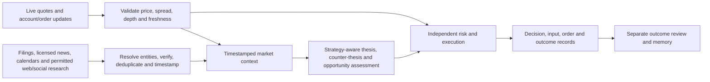

# Market intelligence and trading decision workflow

- **Date:** 13 October 2026, Asia/Kolkata
- **Status:** Proposed design; local captured-evidence implementation resumed by owner on 13 October 2026
- **Scope:** Personal Zerodha expert bot; initial experimentation below ₹10,000
- **Related:** [PRD](PRD.md), [ESOD](ESOD.md), [retained agreements](LIFECYCLE-AGREEMENTS.md), [resume checkpoint](RESUME-PLAN.md)

## Correction to the direction

Continuous market research is a product capability, not just research conducted while designing the software. The bot needs both current tradable prices and an actively maintained picture of company, sector, macro and event developments. General model knowledge and broker candles alone do not provide that picture.

Broker or exchange origin does not establish that a source is delayed. Kite provides live WebSocket quotes; full packets include exchange/trade timestamps and depth. Actual delivery latency still needs measurement. A stream heartbeat establishes connectivity, not a fresh quote for a particular instrument. [Kite streaming documentation](https://kite.trade/docs/connect/v3/websocket/). NSE distinguishes streaming, snapshot, end-of-day, historical and corporate products; identify the actual product before judging its freshness. [NSE data overview](https://www.nseindia.com/static/nse-data-and-analytics).

Browsing is a necessary research tool, but search indexing, publisher updates, provider delivery and model processing introduce their own delays. Neither an official filing nor a headline guarantees that an opportunity remains. Match the data and complete decision latency to the strategy's holding horizon. The proposed first experiment should not rely on winning a subsecond news race.

## Two coordinated paths

**Trading path:** receive broker prices and account/order events, validate them, manage known positions and enforce approved limits. Run this independently of web searches and model requests. Existing protective exits must not wait for a browser, a news provider or an LLM. Recheck price, spread, funds, exposure and proposal age immediately before a prospective order; a research snapshot is not a current executable price or a fill guarantee.

**Intelligence path:** monitor a bounded universe and held positions, ingest permitted sources, investigate meaningful developments and refresh a versioned context. Intelligence produces evidence and structured proposals. It does not receive order credentials or write live risk settings. Research can run concurrently with position protection, within an explicit schedule and request budget.

These are logical responsibilities, not a requirement for multiple services, a swarm on every trade, or an expensive news terminal. Begin with one small service and bounded workers where justified.

## Source and tool plan

| Input or tool | Purpose | Proposed use and limits |
|---|---|---|
| Kite live stream and account/order APIs | Current price, spread/depth, market reaction, portfolio and execution state | Primary candidate for the Zerodha experiment, subject to the appropriate data plan. Measure freshness and recovery; historical candles and last trade alone cannot establish an executable offer. |
| Exchange/company announcements and original documents | Results, guidance, corporate actions, material disclosures and clarifications | Verify an event against its original document and relevant publication time. The [NSE announcement page](https://www.nseindia.com/companies-listing/corporate-filings-announcements) is a primary reference; this does not establish a supported automated endpoint or guaranteed delivery SLA. |
| Official macro/regulatory releases and event calendar | Scheduled rate decisions, policy changes and other relevant releases | Select relevant RBI, government and regulator sources for the chosen strategy. Confirm permitted retrieval, schedule, timezone and actual release values; calendar expectations and outcomes are different fields. |
| Permitted publisher RSS or licensed news API | Routine event discovery and timely reporting | Evaluate Indian-company coverage, delay, correction handling, cost and retention rights. A provider name or a free tier is not sufficient qualification. NewsAPI's free Developer articles have a 24-hour delay and the plan excludes internal production use, so it is not a live operational feed for this bot. [Provider terms](https://newsapi.org/pricing). |
| Web search plus page/document retrieval | Investigate a headline, locate primary evidence, reconcile contradictions and understand sector spillovers | Include read-only browsing in the market-research tool registry. Follow through to originals; a search snippet is insufficient evidence. Cache within allowed rights, preserve versions and disclose inaccessible/paywalled sources. Do not bypass access controls. |
| Permitted social/community access | Detect emerging claims, sentiment changes or questions worth checking | Reddit, public social posts and similar sources are discovery inputs, subject to access terms. Do not assume a real-time social firehose is available. Reels/videos and performance screenshots are not evidence of a strategy's returns. |
| Context calculations on approved data | Price/volume, volatility, liquidity, index/sector conditions, correlations and portfolio concentration | Compute from measured feeds. Add cross-asset inputs only when relevant and affordable; do not pretend the bot observes every market dynamic. |
| TradingView | Optional owner chart inspection | Ordinary platform terms restrict automated/non-display use of market data, including alerts/webhooks. Keep platform-derived data out of machine decisions absent suitable rights; technical availability is not permission. [Current terms, §3](https://www.tradingview.com/policies/). |

Provider selection is unresolved. Before implementation, record coverage, legal use, archive/retention rights, source provenance, delay, rate limits, price and failure behavior in a source registry. Personal use does not automatically establish permission for automated retrieval. Choose the smallest viable set; paid additions need the owner's agreed expense budget and setup.

TradingView now documents an official MCP beta with historical bars, screeners, news, financial documents and calendars, included in Essential and above. It is a candidate for an authorized owner research interface, not established permission for autonomous trading or an execution-grade streaming feed. A blanket claim that TradingView has no programmatic access would be outdated. [Official MCP documentation](https://www.tradingview.com/mcp/docs).

Actual quote delay also depends on instrument, account and entitlement. TradingView's current coverage table lists delayed free NSE/BSE equity data, with differing real-time entitlements; a separate F&O support page uses different wording. Check the actual instrument status rather than promise a universal delay. [Coverage](https://www.tradingview.com/data-coverage/), [F&O access](https://www.tradingview.com/support/solutions/43000777677-can-i-access-real-time-futures-and-options-data-from-nse-and-bse/).

Charting interfaces need separate evaluation. Advanced Charts requires a supplied datafeed; it is not itself a market feed. [Datafeed documentation](https://www.tradingview.com/charting-library-docs/latest/tutorials/implement_datafeed_tutorial/). The later integration decision should use the exact product and allowed use, rather than assume a paid chart subscription licenses a bot feed. No connector or subscription has been set up.

## Operating cadence and triggers

- **Before the session:** refresh relevant overnight/global developments, company events, calendar, holdings and watchlist; prepare scenarios, invalidation conditions and reasons to abstain. Distinguish observations from forecasts.
- **During the session:** keep the trading path running; queue research for a new material event, an approaching scheduled release, a significant source correction, a relevant price/volume anomaly or a change affecting a held thesis. Also run bounded scheduled source checks so quiet price action does not prevent event discovery.
- **Before a new entry:** require the strategy's declared context dependencies and a still-valid proposal; assess any known relevant unresolved event; refresh tradable price and risk. Do not perform an unrestricted internet crawl for every tick.
- **While holding:** monitor mechanical exits continuously as appropriate to the strategy. Separately review relevant events against the stored thesis. Any proposed discretionary reduction/exit needs a registered policy and later evaluation; no automatic stop widening, replacement of exit rules or unapproved risk change.
- **After the session:** reconcile state, review decisions and fills, archive permitted evidence and identify what failed or was missing. Feed lessons into later reviews, preserving the original decision and available information.

Cadence, trigger thresholds, source-specific age limits, research deadlines and budgets are configurable and versioned. Values depend on the first universe/horizon and measured provider behavior; none is approved yet. The schedule is a future product design, not an automation created by this documentation.

## Temporal validity and freshness

For each observation record, where available: source/URL or feed identity, instrument/entity, event time, original publication time, update/correction time, first-seen time, received time, parsing completion, decision time, source version and timezone. Unknown timestamps stay unknown. Measure time to detect, time to verify, model latency and proposal-to-order delay separately.

Record clock-health problems. Exchange timestamps have finite resolution and last-trade age differs from quote/depth age; do not invent millisecond accuracy. Closed markets, illiquid symbols, periodic fundamental reports and streaming quotes need different freshness rules. Report source coverage and missing periods as well as latency distributions.

For an experiment, an input becomes eligible only when its actual usable version was available to the bot. Event time and an article's displayed publication time alone are insufficient. A replay of a revised article cannot present its later text at the original timestamp. Historical data lacking ingestion timing must disclose that limitation and use a stated conservative availability assumption; prospective capture is needed to measure real arrival behavior.

Every strategy declares mandatory and optional inputs. Missing/stale mandatory context expires the affected proposal and suppresses new exposure; optional gaps remain visible. An unrelated source outage need not halt every strategy, but a separately approved price-only mode cannot silently replace a failed news-dependent mode. Model failure behavior from the PRD remains in force. Known positions retain independent protection; an unavailable price or uncertain broker state uses the established incident runbook, not blind orders.

## Claims, rumors and contradictory evidence

Use explicit states: **unverified claim**, **reported with attribution**, **corroborated**, **primary-confirmed**, **disputed**, **retracted**. State what evidence supports each label. A report that an allegation exists is not proof that the allegation is true. Even an official statement may confirm only that a company made a statement; retain contested facts separately.

Resolve company names, exchange symbols and event dates before associating a claim with a position. Check for old stories republished as new, screenshots without originals, spoofed domains, translations losing qualifiers, satire and promotional campaigns. Preserve the original alongside a translation when permitted.

Trace independent origins. Ten outlets repeating one wire story count as one originating report, not ten confirmations. Seek an original filing, issuer clarification or independent reporting; retain denials and corrections without deleting the old evidence. Source reliability is assessed from recorded accuracy over time, not follower count. Do not turn a credibility label or model certainty into an invented probability of profit.

Initial policy: rumors may trigger research, elevate uncertainty or suppress an affected entry; they cannot be the sole basis for opening/increasing a position. Price/volume reaction is evidence of market behavior, not proof of a rumor. Any later rumor/event strategy would require its own permitted-source policy, registered rules, manipulation/retraction cases and prospective evaluation.

## Professional opportunity assessment

The model must answer questions tied to the selected strategy and horizon:

1. What changed, when did we learn it, and how reliable/material is it for this instrument?
2. Is it a surprise relative to documented prior expectations? If expectations are unavailable, state that; positive news is not automatically a positive surprise.
3. How have price, volume, spread, sector peers and the broader market reacted since discovery? Could the move already absorb the thesis, or leave an unfavorable entry? This is an assessment, not knowledge of what every participant priced in.
4. What mechanism could support continuation, reversal or no useful trade? Compare contrary evidence and registered alternatives; sentiment alone is insufficient.
5. Is the opportunity still usable after detection, verification, inference and execution delay, costs and likely slippage? Define the entry, invalidation, exit and proposal expiry.
6. Does it fit the portfolio and available capital? Can the deterministic gate accept it within the approved mandate, or should we abstain?

Capture this as concise decision fields with supporting evidence IDs. News is context for a validated method, not an automatically profitable strategy. The existing selector's two candidate strategies do not yet implement this capability; event strategies must be specified and evaluated before promotion.

## Access, safety and owner steps

Use separate read-only research tools for source lookup/search, permitted fetches, feed queries, context calculations and selected memory. Allow approved services and constrained dynamic retrieval through a broker that blocks local/private addresses, arbitrary executable content and credential access. Retrieved text is evidence, not an instruction to change tools, reveal secrets or place orders. Test malicious content and redirects before operation.

Log tool requests, source versions, failures, timeouts, coverage and spending. Store permitted evidence for reconstruction; where raw content retention is restricted, preserve allowed metadata/hashes/excerpts and disclose replay limits. Do not claim complete replay from a URL alone. Credentials remain outside prompts and exports.

The owner chooses subscriptions and budgets, completes provider/account setup and authorizes the eventual live mandate. Once configured and separately authorized for the relevant stage, routine retrieval and eligible decisions can run within those limits without per-search approval. Current work implements the local captured-evidence path; operational source connections are a later stage.

## Evaluation and acceptance

Compare price-only rules, the same rules with verified intelligence, and constrained model-assisted decisions under matched universe, periods, exposure, execution assumptions and operating costs. If rumor monitoring is enabled, measure its incremental value separately. Preserve all variants and losing periods.

Record detection/verification latency, stale or missed events, duplicated stories, false entity matches, corrections, unavailable sources, proposal expiry and no-trade decisions. Test contradictory reports, an old story resurfacing, fake evidence, source outages and events that arrive after a price move. Use captured evidence as it arrived; do not backfill a profitable trade from later reporting.

Require measurable improvement in the declared capability and economic assessment before adding source cost or promoting a strategy. More browsing, providers or agents do not by themselves improve decisions. See PRD R-020–R-022 for stage acceptance and the resume plan for unfinished work.

## Documentation checkpoint

The correction adds continuous research, source qualification, available-time recording, rumor controls and latency-aware trade assessment to the retained expert vision. Models, editable settings, logging, snapshots, cost accounting, private operation, recovery and independent risk remain required. Live feeds/browser research and a news trading strategy are not established by the local fixture implementation. The owner has resumed the scoped paper build; implementation evidence belongs in the resume checkpoint.
